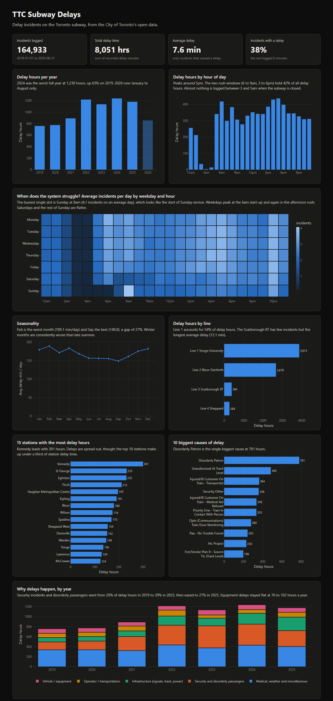

# TTC Subway Delays: SQL Analysis and Dashboard

An analysis of Toronto subway delays from January 2019 to August 2026, built on the City of Toronto's open data. The raw files are loaded into SQLite, cleaned and analysed in SQL, and summarised in an interactive dashboard.

**Live dashboard:** https://nrozario08.github.io/ttc-subway-delays/ (also runs offline: open `docs/index.html` in a browser).

[](https://nrozario08.github.io/ttc-subway-delays/)

## Why this project

Over the summer I was living and working in Toronto, and the delays on my commute were inconsistent. Some days the trip took its usual time, and other days it ran well over, which made it hard to time my departure to and from work. I either left too early and waited around, or left on time and arrived late.

That raised a few questions. Are delays worse in the morning rush or at the start of service? Does winter really make things worse? Are certain stations or lines the problem, and are delays caused by equipment failures or by something else entirely?

The City of Toronto publishes a log of every subway delay, but it comes as a stack of yearly spreadsheets with inconsistent line names, hundreds of station spellings, and delay codes that need a separate lookup table, so those questions can't be answered from the raw files as they are.

This project turns that log into something usable. It cleans seven years of records in SQL, answers those questions with queries anyone can re-run, and presents the results in a dashboard that someone without a SQL background can read.

## Data

[TTC Subway Delay Data](https://open.toronto.ca/dataset/ttc-subway-delay-data/) from the City of Toronto Open Data portal: one row per logged incident with date, time, station, line, direction, delay code, minutes of delay and vehicle number. Delay code descriptions come from the portal's code tables.

| | |
|---|---|
| Period | 2019-01-01 to 2026-08-31 |
| Raw rows | 165,160 |
| Rows after cleaning | 164,933 |
| Delay codes | 212 (subway, SRT and newer codes combined) |

## Method

1. **Load** (`src/build_db.py`): stack the yearly Excel/CSV files (2019 to 2021 are split into monthly sheets) into a `delays_raw` table in SQLite, and merge the two delay code tables into `delay_codes`.
2. **Clean in SQL** (`sql/01_clean.sql`):
   - Line labels had dozens of spellings (`YU`, `YUS`, `LINE 1`, `YU / BD` ...); mapped to Line 1, 2, 3 (Scarborough RT), 4, or Multiple lines.
   - Station names carried line tags and truncated text (`KENNEDY BD STATION`, `PIONEER VILLAGE STATIO`); about 2,000 raw spellings were reduced to a station dimension table of 79 stations with at least 150 incidents each. Non-station entries (yards, whole-line entries, segments) are excluded from station analysis.
   - Exact duplicate rows removed with `ROW_NUMBER()`.
   - Weekday recomputed from the date; invalid times dropped.
   - Delay codes joined to descriptions and rolled up into five categories (vehicle/equipment, infrastructure, security and disorderly passengers, operator/transportation, medical/weather/misc).
3. **Analyse** (`sql/02` to `sql/05`): CTEs, window functions (`LAG`, `RANK`, `ROW_NUMBER`, running totals with `SUM() OVER`), conditional aggregation and self-comparisons across years.
4. **Export and visualise** (`sql/06`, `src/export_dashboard.py`, `docs/`): the dashboard queries are exported to JSON and drawn with Plotly.

## Key findings

All figures use full years (2019 to 2025) unless noted.

- **Trend:** delay time rose from about 758 hours in 2019 to 1,238 hours in 2024 (+63%), then eased to about 1,180 hours in 2025. Across the whole dataset there are 8,051 delay hours and the average delay is 7.6 minutes.
- **Timing:** the 6 to 9am and 3 to 6pm windows hold 42% of delay hours. Weekdays average 178 delay minutes a day versus 145 on weekends. February is the worst month (189 minutes/day) and September the best (149), a 27% gap.
- **Lines:** Line 1 accounts for 54% of delay minutes and Line 2 for 37%. The Scarborough RT had the longest average delay (12.1 minutes) before it closed in July 2023.
- **Stations:** Kennedy has the most delay time (about 301 hours). Delays are spread out: the 10 worst stations account for 29.6% of station delay minutes. Eglinton, Wilson, Lawrence and Rosedale more than doubled their delay minutes between 2019 and 2025.
- **Causes:** 36 of 209 delay codes explain 80% of delay minutes. Disorderly patrons is the largest single cause (10.9% of minutes). Security and disorderly-passenger incidents went from 20% of delay minutes in 2019 to 39% in 2023 and 27% in 2025, while equipment-related delay hours stayed roughly flat at 76 to 102 hours per year.
- **Worst days:** the three worst days in the data were January 25 and 26, 2026 (ice and snow) and February 16, 2025 (weather), each with over 2,300 delay minutes.

## Repository layout

```
sql/
  01_clean.sql              cleaning and station/line/code standardisation
  02_overview.sql           totals and year-over-year change
  03_timing.sql             hour, weekday, month patterns
  04_locations.sql          lines, stations, biggest movers
  05_causes.sql             causes, pareto, worst days
  06_dashboard_exports.sql  result sets used by the dashboard
src/
  download_data.py          fetch raw files from the open data portal
  build_db.py               load raw files into SQLite and run the cleaning SQL
  run_sql.py                run a .sql file and print the results
  export_dashboard.py       export dashboard data to docs/data.js
docs/
  index.html, dashboard.js, data.js, vendor/plotly.min.js
```

## Running it

```bash
pip install pandas openpyxl
python src/download_data.py       # downloads about 9 MB into data/raw/
python src/build_db.py            # builds data/ttc.db
python src/run_sql.py sql/02_overview.sql
python src/export_dashboard.py    # refreshes the dashboard data
```

Then open `docs/index.html`.

## Notes and limitations

- 2026 covers January to August only, so yearly comparisons stop at 2025.
- About 62% of logged incidents record zero delay minutes. "Delay minutes" means minutes actually recorded, not the number of incidents.
- 16 delay codes (1,532 rows) have no description in the portal's code tables and are labelled `UNKNOWN CODE`.
- Exact duplicate rows are treated as data entry duplicates and removed. Two genuine incidents with identical details would be collapsed too.
- The delay-code categories are grouped by the first letter of the code, based on the code descriptions.
- Heatmap uses average incidents per day instead of delay minutes because a few severe-weather days distort the minutes average.

## Source and licence

Contains information licensed under the [Open Government Licence – Toronto](https://open.toronto.ca/open-data-license/).
